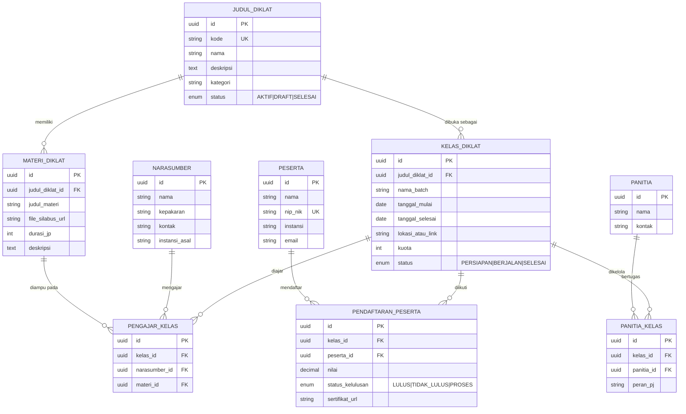
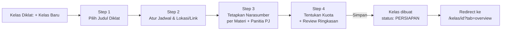

# Arsitektur Sistem Informasi Manajemen Diklat

## 1. Ringkasan Tech Stack

| Layer | Pilihan | Alasan |
|---|---|---|
| Frontend | Next.js (App Router) + Tailwind CSS + shadcn/ui + Lucide Icons | SSR untuk dashboard cepat, komponen aksesibel siap pakai, ikon konsisten |
| State/Data fetching | TanStack Query (React Query) | Caching & sinkronisasi data server (peserta, kelas) yang sering berubah |
| Backend | Node.js (Next.js Route Handlers atau NestJS terpisah) | Konsisten satu bahasa (TypeScript) full-stack |
| Database | PostgreSQL | Relasional, cocok untuk data terstruktur & pelaporan |
| ORM | Prisma | Migration aman, type-safe query, cocok untuk skema relasi 6 entitas |
| File storage | Supabase Storage / S3-compatible | Silabus, sertifikat, foto peserta |
| Auth | NextAuth / Supabase Auth (role: Admin, Panitia, Narasumber, Peserta) | Portal peserta butuh akses berbeda dari admin |
| Export/Import | `exceljs` (export) + `papaparse`/`xlsx` (import) | Kebutuhan Tab Peserta |

Alternatif cepat (MVP/POC): ganti Node.js+PostgreSQL+Prisma dengan **Supabase** (Postgres + Auth + Storage sekaligus), skema tabel tetap sama persis.

---

## 2. Skema Database (ERD)

Prinsip normalisasi: 3 tabel inti (Judul Diklat, Materi, Kelas) berelasi 1‑ke‑banyak searah dokumen; sedangkan Peserta, Narasumber, dan Panitia bersifat **master data global** yang dihubungkan ke Kelas Diklat lewat **tabel penghubung (junction table)**, karena satu orang bisa terlibat di banyak kelas, dan satu kelas punya banyak orang — dengan atribut tambahan yang melekat pada relasi itu sendiri (nilai, status kelulusan, peran PJ, materi yang diampu).



**Catatan desain penting:**
- `PENDAFTARAN_PESERTA` adalah tabel enrolment — di sinilah `nilai` dan `status_kelulusan` disimpan (bukan di tabel `PESERTA`), karena satu peserta bisa ikut banyak kelas dengan hasil berbeda-beda.
- `PENGAJAR_KELAS` menghubungkan tiga entitas sekaligus (kelas + narasumber + materi spesifik), sesuai kebutuhan "narasumber diplot ke kelas dan materi tertentu".
- Skema Prisma lengkap ada di file terpisah `schema.prisma` (siap `prisma migrate dev`).

---

## 3. Arsitektur Navigasi (Information Architecture)

```
├── /dashboard                         (Admin/Panitia — statistik & grafik)
├── /diklat                            (Judul Diklat — list + CRUD)
│   └── /diklat/[id]                   (detail judul diklat + daftar materi & kelas turunannya)
├── /materi                            (Materi Diklat — list global, filter per Judul Diklat)
├── /kelas                             (Kelas Diklat — list semua batch, badge status warna)
│   ├── /kelas/baru                    (Form Wizard 4 langkah)
│   └── /kelas/[id]                    (Detail Kelas — TABBED VIEW)
│         ├── ?tab=overview
│         ├── ?tab=materi-narasumber
│         ├── ?tab=peserta
│         └── ?tab=panitia
├── /narasumber                        (Master data narasumber)
├── /panitia                           (Master data panitia)
├── /peserta                           (Master data peserta, lintas kelas)
└── /portal                            (Role: Peserta)
    ├── /portal/jadwal
    ├── /portal/materi
    └── /portal/sertifikat
```

### User Flow — Membuat Kelas Diklat Baru (Form Wizard)



### User Flow — Admin Mengelola Peserta di Sebuah Kelas

```mermaid
flowchart LR
    A[/kelas/id?tab=peserta] --> B{Aksi}
    B -->|Cari/Filter| C[Tabel ter-filter\nby nama/status]
    B -->|Import| D[Upload Excel/CSV\n→ validasi baris\n→ konfirmasi]
    B -->|Export| E[Unduh Excel/CSV\nsesuai filter aktif]
    B -->|Klik baris| F[Detail peserta:\ninput nilai & status kelulusan]
    F --> G[Sertifikat auto-generate\njika status = LULUS]
```

### Wireframe ASCII — Layout Utama

```
┌───────────┬───────────────────────────────────────────────────────────┐
│  SIDEBAR  │  Topbar: Kelas Diklat / Diklat Kepemimpinan Angkatan 12    │
│  (navy)   │  [Badge: Berjalan]                    [Edit] [•••]         │
│           ├───────────────────────────────────────────────────────────┤
│ Dashboard │  Strip info: 📅 12 Sep–20 Sep  |  👥 24/30 peserta  |  🎓 8 JP │
│ Diklat    ├───────────────────────────────────────────────────────────┤
│ Materi    │  Overview | Materi & Narasumber | Peserta | Panitia        │
│ Kelas ◄   │  ─────────                                                 │
│ Peserta   │                                                            │
│ Narasumber│   [ konten tab aktif ]                                     │
│ Panitia   │                                                            │
│ Portal    │                                                            │
└───────────┴───────────────────────────────────────────────────────────┘
```

---

## 4. Sistem Desain (ringkas)

- **Warna dasar**: Navy `#16233F` (sidebar/struktur), Emas tua `#B8892B` (aksen kelulusan/sertifikat), Paper `#F6F4EF` (background), Ink `#1C2130` (teks). Status: Sukses `#2F7D5C`, Proses `#B7791F`, Gagal `#B4373A`.
- **Tipografi**: "Source Serif 4" untuk judul (kesan formal dokumen kedinasan), "Inter" untuk UI/tabel/data (keterbacaan tinggi di tabel padat).
- **Struktur visual**: border/garis pemisah lebih diutamakan daripada shadow; status ditandai garis aksen 4px di kiri panel + dot warna pada badge, bukan kartu seragam bershadow sama semua.
- **Komponen kunci**: Sidebar navigation tetap, Tab underline (bukan pill), Badge status dot+label, Stat strip inline (bukan kartu KPI generik berulang).
