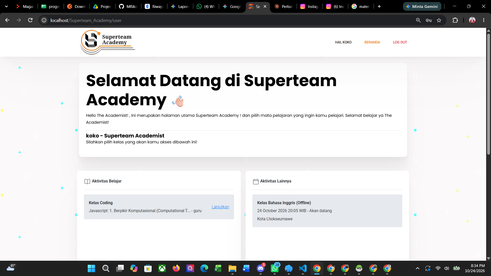
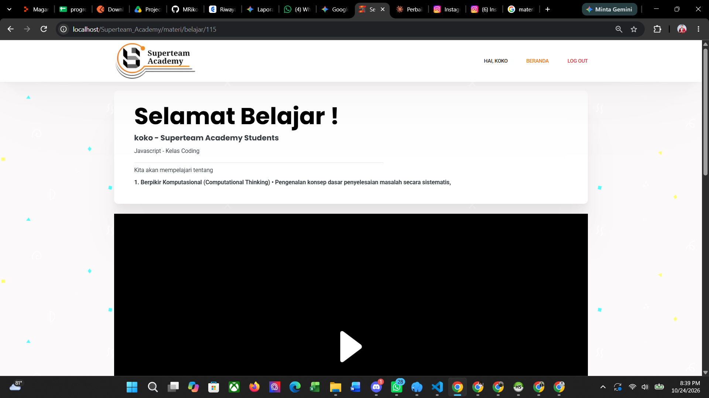

<p align="center">
  
</p>

<h1 align="center">Superteam Academy</h1>
<p align="center"><em>Jalani prosesnya, nikmati hasilnya.</em></p>

<p align="center">
  
  
  
</p>

Superteam Academy adalah platform pembelajaran daring berbasis web untuk mengelola kelas, materi video, dan jadwal tatap muka. Sistem ini memiliki tiga peran pengguna: **siswa**, **guru**, dan **admin**. Siswa belajar dari materi kelas yang diikuti, guru mengunggah materi, dan admin mengelola seluruh data.

## Tampilan

| Beranda siswa | Halaman materi |
|---|---|
|  |  |

> Gambar di atas adalah tampilan awal. Setelah menerapkan desain baru (putih dan oranye), ganti file di `docs/images/` dengan tangkapan layar terbaru, dengan nama file yang sama.

## Fitur

### Siswa
- Registrasi akun, masuk, dan keluar.
- Beranda berisi kartu **Lanjutkan belajar**, daftar materi dari kelas yang diikuti, serta jadwal tatap muka.
- Filter materi per kelas dan pencarian materi atau pengajar.
- Halaman materi dengan pemutar video, deskripsi lengkap, daftar materi di kelas yang sama, dan tombol sebelumnya/berikutnya.
- Jadwal tatap muka dengan hitung mundur, tombol **Tambah ke kalender** (Google Calendar), dan **Lihat peta** dari lokasi.
- Siswa hanya bisa membuka materi dari kelas yang ia ikuti.

### Guru
- Masuk ke dashboard guru.
- Menambah materi (mata pelajaran, kelas, deskripsi, dan video).

### Admin
- Dashboard ringkasan dan jumlah siswa aktif per kelas (Coding, Bahasa Inggris, Public Speaking).
- Manajemen **siswa**: lihat, detail, ubah, hapus, dan atur kelas yang diikuti.
- Manajemen **guru**: tambah, lihat, detail, ubah, hapus.
- Manajemen **materi**: tambah, ubah, hapus, dan isi otomatis nama mapel.
- Manajemen **kelas** dan jadwal: tambah, ubah, hapus (waktu dan lokasi tatap muka).

## Kelas yang tersedia

| Kelas | Kolom siswa |
|---|---|
| Kelas Coding | `kelas_coding` |
| Kelas Bahasa Inggris | `kelas_inggris` |
| Kelas Public Speaking | `kelas_speaking` |

Materi dan jadwal dicocokkan ke kelas siswa lewat kata kunci pada kolom `kelas` (misalnya `coding`, `inggris`, `speaking`).

## Teknologi

- **Backend:** PHP dengan CodeIgniter 3 (arsitektur MVC)
- **Database:** MySQL / MariaDB, driver `mysqli`
- **Frontend:** HTML, CSS, dan JavaScript murni (tanpa framework) pada halaman siswa
- **Font:** Bricolage Grotesque dan Plus Jakarta Sans (Google Fonts)
- **Lingkungan pengembangan:** Laragon atau XAMPP

## Struktur proyek

```
Superteam_Academy/
├── application/
│   ├── controllers/   Welcome, User, Materi, Guru, Admin
│   ├── models/        M_siswa, M_guru, M_materi, M_kelas
│   ├── views/
│   │   ├── user/      beranda dan registrasi siswa
│   │   ├── materi/    halaman belajar
│   │   ├── guru/      halaman guru
│   │   ├── admin/     halaman admin
│   │   └── template/  navbar dan footer
│   └── config/        database, routes, config
├── assets/
│   ├── css/           user_redesign.css
│   ├── img/           logo dan ikon
│   └── materi_video/  video materi (tidak ikut repo)
└── docs/images/       tangkapan layar untuk README
```

## Instalasi

1. **Kloning repositori** ke folder web server.
   ```bash
   git clone https://github.com/MRikoKuswoyo/Superteam_Academy.git
   ```
   Letakkan di `C:\laragon\www\` (Laragon) atau `C:\xampp\htdocs\` (XAMPP).
2. **Buat database** bernama `superteam_academy` di phpMyAdmin, lalu impor berkas SQL proyek. Tabel yang dipakai: `siswa`, `guru`, `admin`, `materi`, `kelas`, dan `token`.
3. **Atur koneksi database** di `application/config/database.php`.
   ```php
   'hostname' => 'localhost',
   'username' => 'root',
   'password' => '',
   'database' => 'superteam_academy',
   ```
4. **Atur base URL** di `application/config/config.php`.
   ```php
   $config['base_url'] = 'http://localhost/Superteam_Academy/';
   ```
5. **Siapkan folder video.** Buat `assets/materi_video/` dan pastikan bisa ditulis oleh server.
6. Jalankan Apache dan MySQL, lalu buka `http://localhost/Superteam_Academy/`.

## Alur penggunaan

1. Siswa mendaftar, lalu admin mengaktifkan kelas siswa tersebut.
2. Guru atau admin menambahkan materi dan video untuk kelas yang sesuai.
3. Admin menambahkan jadwal tatap muka di Manajemen Kelas.
4. Siswa masuk, membuka **Beranda**, lalu memilih **Lanjutkan belajar** atau **Buka materi**.

## Keamanan

- Jangan mengunggah `application/config/database.php` yang berisi kata sandi asli. Pakai berkas contoh dengan nilai kosong.
- Kata sandi disimpan dengan `password_hash()`.
- Keluaran ke halaman dilindungi `html_escape()`.
- Isi `smtp_user` dan `smtp_pass` hanya di server, jangan di repositori.
- Halaman siswa, guru, dan admin dilindungi pemeriksaan sesi dan peran.

## Penerbit

Dikembangkan dan diterbitkan oleh **MRikoKuswoyo** dan **Team Programmer Superteam Batch 7 UPTBKK Universitas Malikussaleh**.
