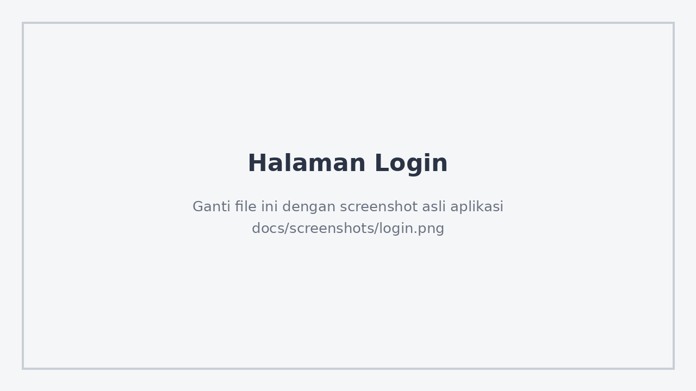
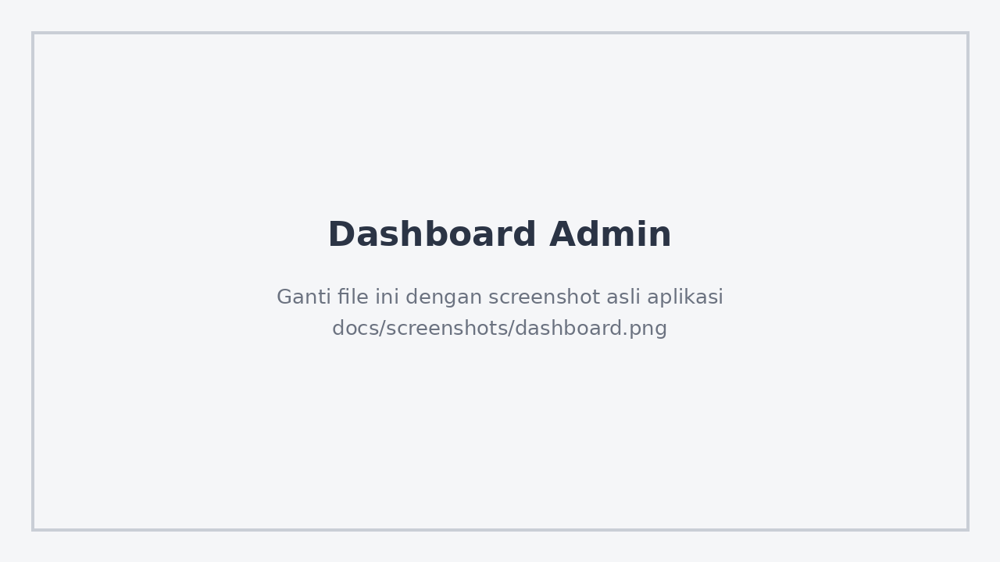
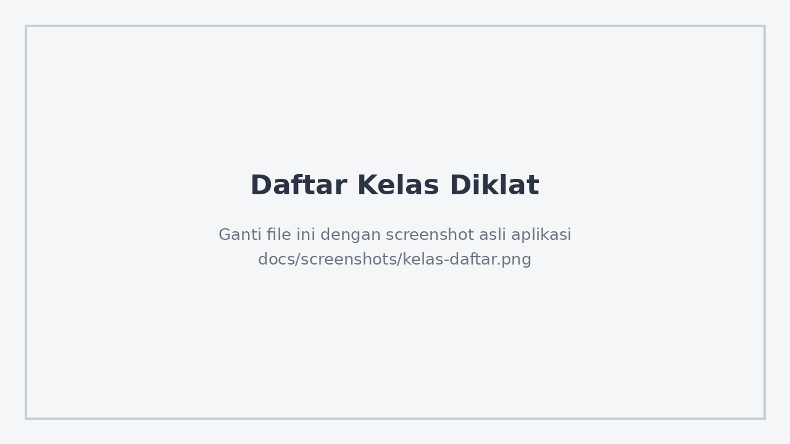
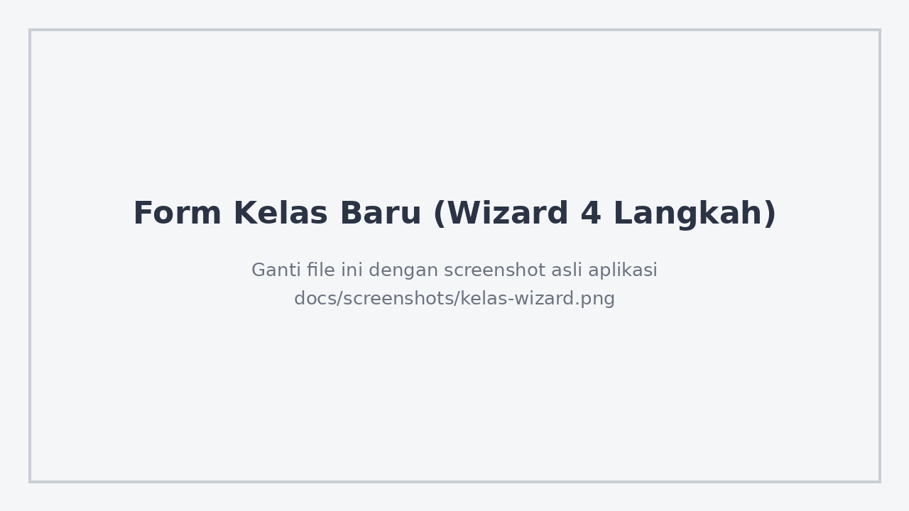
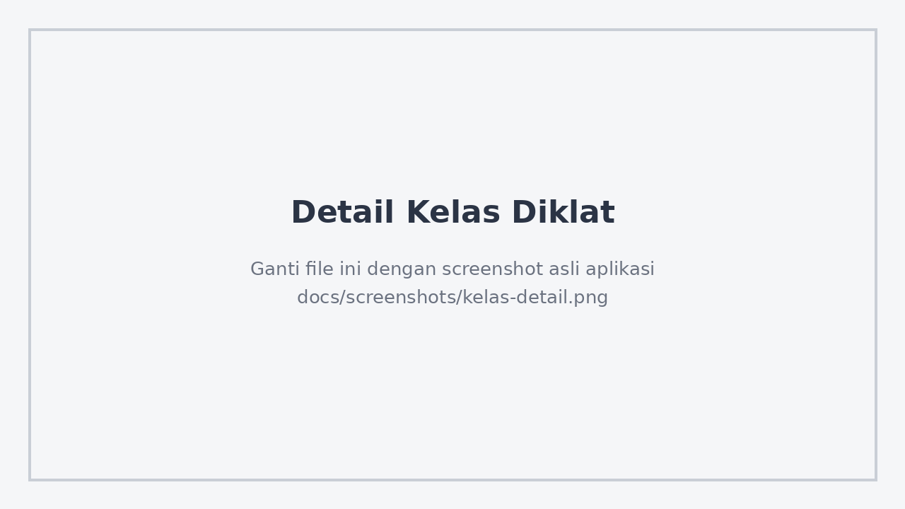
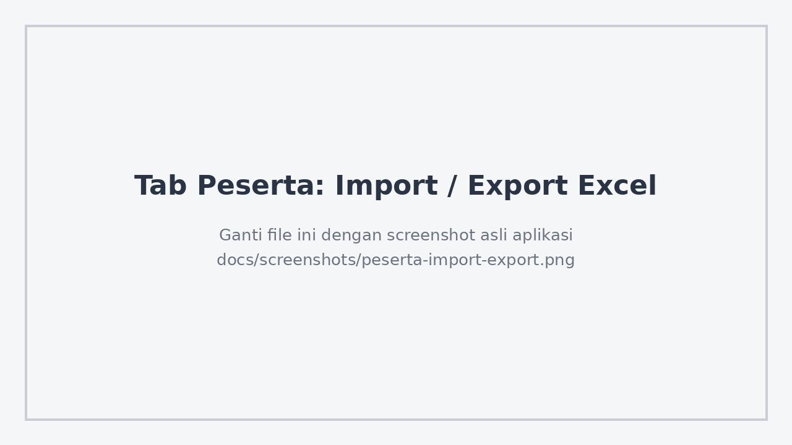
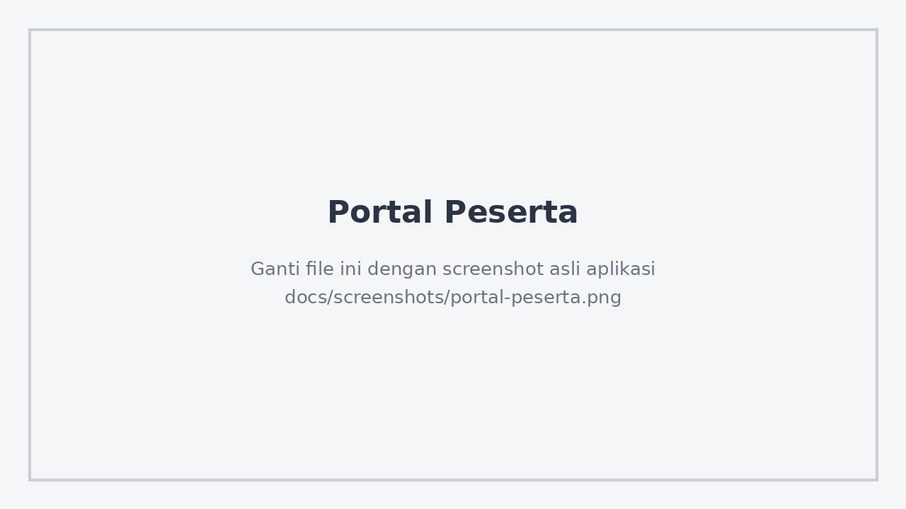
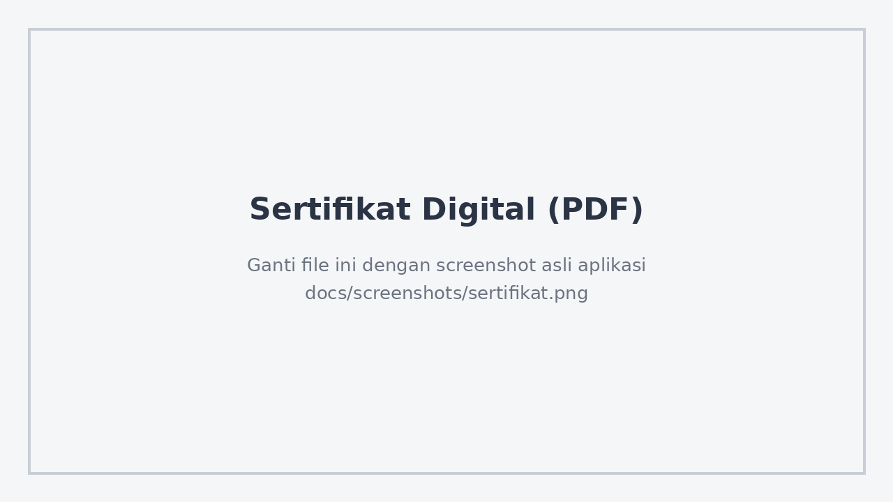

<h1 align="center">SIM Diklat</h1>
<p align="center"><strong>Sistem Informasi Manajemen Diklat</strong><br>BBGTK Provinsi Sumatera Utara</p>

<p align="center">
  
  
  
  
</p>

SIM Diklat adalah aplikasi web untuk mengelola penyelenggaraan pendidikan dan pelatihan (diklat), mulai dari judul diklat, materi, kelas, peserta, narasumber, dan panitia, sampai penerbitan sertifikat digital. Sistem punya dua peran: **Admin** yang mengelola seluruh data, dan **Peserta** yang melihat jadwal, materi, dan sertifikatnya lewat portal.

## Tampilan

| Login | Dashboard admin |
|---|---|
|  |  |

| Daftar kelas | Form kelas baru (wizard) |
|---|---|
|  |  |

| Detail kelas | Import / export peserta |
|---|---|
|  |  |

| Portal peserta | Sertifikat digital |
|---|---|
|  |  |

## Fitur

### Admin
- **Dashboard** dengan data asli: jumlah Diklat Aktif, Total Peserta, Kelas Berjalan, persentase kelulusan, progress bar kelulusan, dan 5 kelas terbaru.
- **Judul Diklat, Materi, Peserta, Narasumber, Panitia:** daftar data dengan tambah, ubah, dan hapus lewat modal.
- **Kelas Diklat:** daftar kelas, **wizard 4 langkah** untuk membuat kelas baru (pilih judul diklat, jadwal dan lokasi, narasumber per materi dan panitia, lalu kuota dan review), serta halaman detail bertab: Overview, Materi, Peserta, Panitia.
- **Manajemen peserta di dalam kelas:**
  - Export daftar peserta ke file `.xlsx`.
  - Import peserta dari `.xlsx` atau `.csv`. Setiap baris otomatis didaftarkan ke kelas.
  - Ubah nilai, status kelulusan, dan link sertifikat.
  - Keluarkan peserta dari kelas.
  - Tambah peserta baru, atau cari dari data yang sudah ada.
- **Sertifikat digital:** PDF dibuat langsung oleh sistem (tanpa penyimpanan eksternal). Nomor sertifikat diisi manual oleh admin, dan tombol unduh baru muncul setelah nomor terisi. Admin juga bisa memakai "Link Sertifikat Kustom" untuk file yang ditandatangani di luar sistem.
- **Sidebar navigasi** yang menyesuaikan peran pengguna.

### Peserta (Portal)
- Melihat jadwal kelas yang diikuti.
- Melihat daftar materi per kelas dan mengunduh silabus.
- Mengunduh sertifikat untuk kelas dengan status **Lulus**.

### Keamanan
- Login dengan sesi **JWT di cookie httpOnly**.
- `middleware.js` melindungi rute admin dan portal sesuai peran.
- Semua endpoint tulis (POST, PUT, PATCH, DELETE) hanya bisa diakses peran `ADMIN`.

## Teknologi

| Bagian | Teknologi |
|---|---|
| Framework | Next.js (App Router) |
| Tampilan | Tailwind CSS |
| ORM dan database | Prisma dengan MySQL (Laragon) |
| Autentikasi | JWT pada cookie httpOnly |
| Excel | `xlsx` (SheetJS) |
| Sertifikat PDF | `pdf-lib` |

PostgreSQL juga bisa dipakai. Ganti `provider = "mysql"` menjadi `"postgresql"` di `prisma/schema.prisma`, lalu sesuaikan `DATABASE_URL` di `.env`.

## Struktur proyek

```
sim-diklat/
├── prisma/
│   ├── schema.prisma     6 entitas inti dan relasinya
│   ├── migrations/       riwayat struktur database
│   └── seed.ts           data awal (akun demo)
├── src/
│   ├── app/
│   │   ├── (app)/        halaman admin dengan sidebar (dashboard, kelas, dan lainnya)
│   │   ├── login/        halaman masuk
│   │   ├── register/     pendaftaran akun
│   │   ├── portal/       portal peserta
│   │   ├── absen/        halaman absensi
│   │   ├── verifikasi/   verifikasi
│   │   ├── pilih/        halaman pilihan
│   │   └── api/          API routes (CRUD, auth, sertifikat)
│   ├── components/       Sidebar, KelasDiklatDetail, crud/*Manager
│   ├── lib/              prisma.js, auth.js, certificate.js
│   └── middleware.js     proteksi rute berdasarkan peran
├── public/uploads/       berkas unggahan (isi tidak ikut repositori)
├── ARSITEKTUR-DIKLAT.md  ERD, arsitektur navigasi, user flow, sistem desain
├── PANDUAN-MOODLE.md     panduan pendukung
└── prototype-demo.html   prototipe interaktif satu berkas
```

## Instalasi dan menjalankan (Laragon)

1. Di Laragon klik **Start All**, lalu buat database `sim_diklat` lewat HeidiSQL.
2. Jalankan di terminal proyek:

```bash
npm install
cp .env.example .env      # default sudah mengarah ke MySQL Laragon
npx prisma migrate dev --name init
npm run db:seed           # membuat akun demo
npm run dev
```

3. Buka `http://localhost:3000`. Kamu akan diarahkan ke `/login`.

> **Catatan pembaruan:** setelah `git pull`, jalankan `npm install` kembali karena ada dependensi `xlsx` dan `pdf-lib`. Jalankan juga `npx prisma migrate dev` agar kolom `nomor_sertifikat` ikut dibuat di database.

### Akun demo

| Peran | Email | Kata sandi |
|---|---|---|
| Admin | admin@diklat.go.id | Admin123! |
| Peserta | andi.saputra@pemko.go.id | Peserta123! |

Akun ini hanya untuk pengembangan. **Ganti atau hapus sebelum sistem dipakai sungguhan.**

## Ringkasan endpoint API

| Method | Path | Keterangan |
|---|---|---|
| POST | `/api/auth/login` | Login, set cookie sesi |
| POST | `/api/auth/logout` | Hapus cookie sesi |
| GET | `/api/auth/me` | Info pengguna yang sedang login |
| GET/POST | `/api/diklat` | Daftar / buat Judul Diklat |
| GET/PUT/DELETE | `/api/diklat/[id]` | Detail / ubah / hapus |
| GET/POST | `/api/materi` | Daftar (filter `?judulDiklatId=`) / buat Materi |
| GET/PUT/DELETE | `/api/materi/[id]` | Detail / ubah / hapus |
| GET/POST | `/api/kelas` | Daftar / buat Kelas Diklat |
| GET/PUT/DELETE | `/api/kelas/[id]` | Detail / ubah / hapus |
| POST | `/api/kelas/[id]/peserta` | Daftarkan peserta ke kelas |
| PATCH/DELETE | `/api/kelas/[id]/peserta/[pesertaId]` | Ubah nilai dan status / keluarkan |
| POST | `/api/kelas/[id]/narasumber` | Tetapkan narasumber ke materi |
| POST | `/api/kelas/[id]/panitia` | Tetapkan panitia dan perannya |
| GET/POST | `/api/peserta` | Daftar (filter `?q=`) / buat Peserta |
| GET/PUT/DELETE | `/api/peserta/[id]` | Detail / ubah / hapus |
| GET/POST | `/api/narasumber` | Daftar / buat Narasumber |
| GET/PUT/DELETE | `/api/narasumber/[id]` | Detail / ubah / hapus |
| GET/POST | `/api/panitia` | Daftar / buat Panitia |
| GET/PUT/DELETE | `/api/panitia/[id]` | Detail / ubah / hapus |
| GET | `/api/sertifikat/[pendaftaranId]` | Hasilkan PDF sertifikat |

## Pengembangan lanjutan

- Font khusus (Cinzel, Great Vibes, Montserrat) untuk sertifikat.
- Notifikasi email.
- Laporan dan rekap per periode.
- Halaman ubah Kelas Diklat.
- Peran tambahan: Narasumber dan Panitia dengan login sendiri.

## Dokumen pendukung

- `ARSITEKTUR-DIKLAT.md`: ERD, arsitektur navigasi, user flow, dan sistem desain.
- `prototype-demo.html`: prototipe interaktif yang bisa dibuka langsung di browser tanpa `npm install`.

## Penerbit

Dikembangkan dan diterbitkan oleh:

- **MRikoKuswoyo**
- **Divisi Pranata Komputer, Tim DIGITAL BBGTK Provinsi Sumatera Utara**
- **MagangHub Batch 2**

## Hak Cipta

&copy; 2026 **MRikoKuswoyo**, **Divisi Pranata Komputer Tim DIGITAL BBGTK Provinsi Sumatera Utara**, dan **MagangHub Batch 2**. Seluruh hak cipta dilindungi undang-undang.

Perangkat lunak ini dilindungi berdasarkan Undang-Undang Nomor 28 Tahun 2014 tentang Hak Cipta. Dilarang menggandakan, mendistribusikan, atau memodifikasi sebagian maupun seluruh isi repositori ini tanpa izin tertulis dari pemegang hak cipta.
